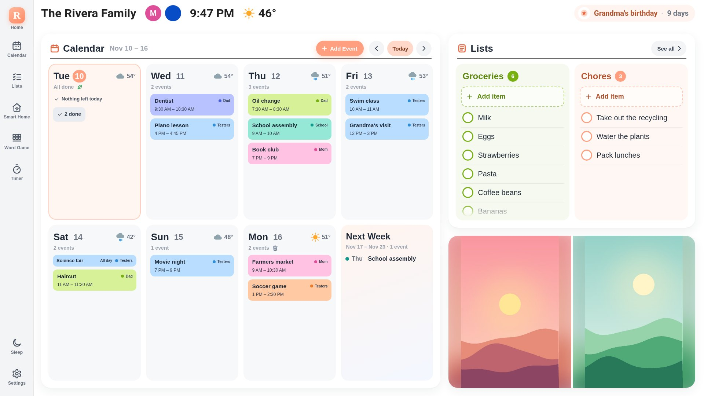
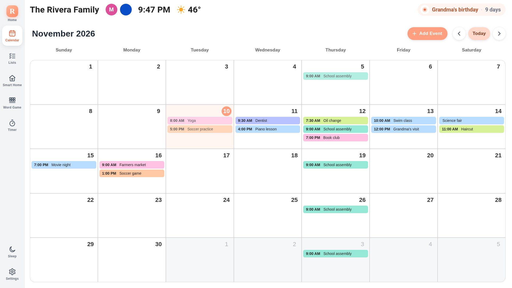
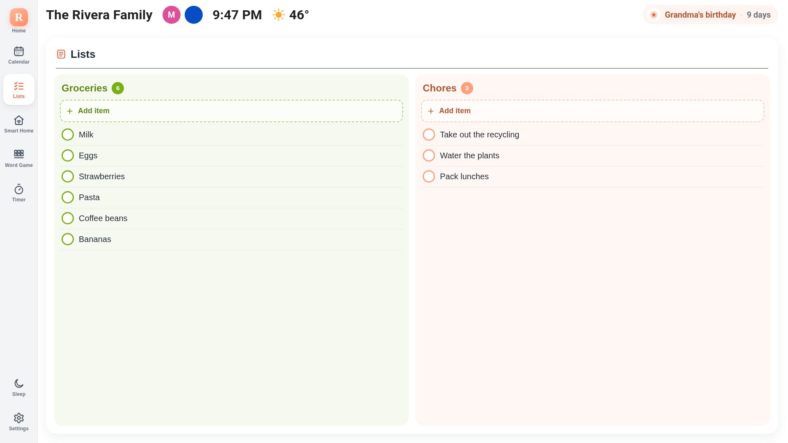
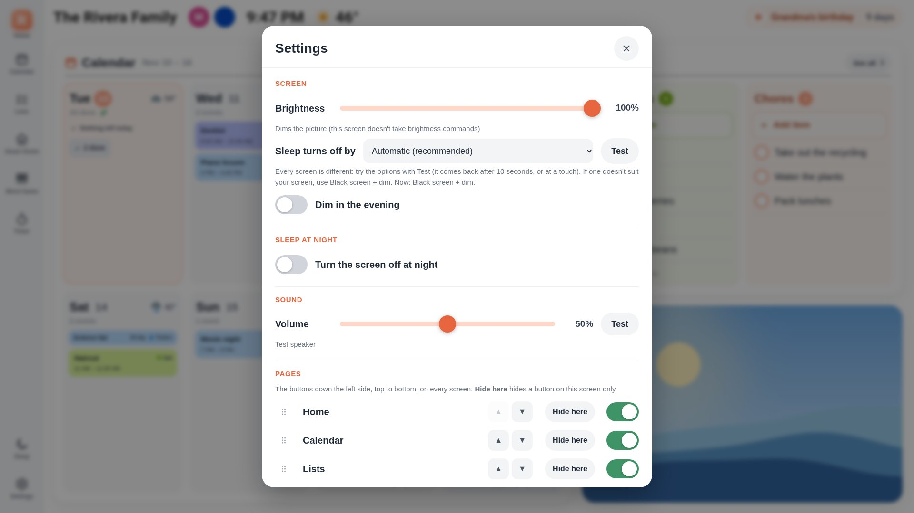
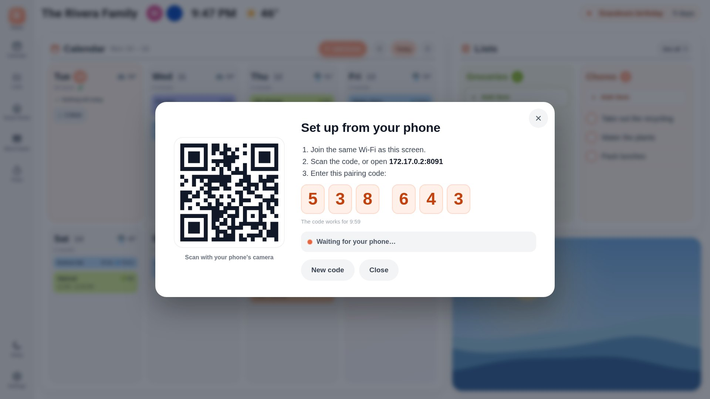

A friendly family wall calendar and home dashboard for a Raspberry Pi touchscreen — the week ahead, shared lists,
timers, photos, weather and smart-home controls on one screen. Built on [MagicMirror²](https://magicmirror.builders/).

[Get started: Install](install.md){: .button }

**Watch the intro video** (YouTube):

## What you get
- **Home:** the week ahead with everyone's events in their colors, weather, trash-day icons, your lists and a photo. Choose and order the cards (notes, dinner tonight, lists, photos).
- **Calendar:** month / two-week / week view; tap to see, add, edit or delete events.
  - Works with Google, Outlook, iCloud, Fastmail, Nextcloud or any calendar link — or no account at all.
  - **Quick add:** type or say "dentist Thursday at 3" and it fills in the New Event form for you to check (needs an AI server on your network: llama.cpp, Ollama…, optional).
  - Show only some events of a calendar, put one event on several calendars, and show today's event in the header.
- **Lists:** to-dos and groceries — kept on the Pi, or in Todoist, Home Assistant or Mealie. Check off with Undo.
- **Chores:** a page of each kid's chores for today from Greenlight (unofficial), with a count on their circle in the header.
- **Meals:** a meal plan on a Meals page, "Dinner tonight" on Home and the calendar — planned right on the screen, or from Mealie with recipes and one-tap "add ingredients to my shopping list".
- **Weather:** a page with the next 24 hours, weather alerts (US) and an animated rain radar — free, no account.
- **Countdowns:** a trip, a birthday or a big day with days to go, a title and a photo — a card on Home (a banner on a portrait screen) and an optional page; set up on your phone, hides itself after the date.
- **Share:** family members add photos, notes and countdowns to the screen from their own phones with a family passcode (no access to settings).
- **Timer**, holiday & birthday countdown, your team's game day, sleep button, photos from a folder, USB stick or Immich.
- **Devices:** Home Assistant lights, switches, locks and sensors as tappable tiles (a lock asks twice) — pick them on your phone.
- **Look:** light, dark or automatic dark mode, text size and accent color, a compact layout for small screens and a portrait layout for vertical monitors, a photo screensaver, and event reminders (a chime and/or a banner before an event).
- **Several screens:** screen profiles give each tablet or wall display its own pages, person, text size and color. Runs on a Pi or in Docker.
- **Add-on — Music:** the screen becomes an AirPlay and Spotify speaker, with a Music page
  ([details](music.md)): `opensky addon music`.
